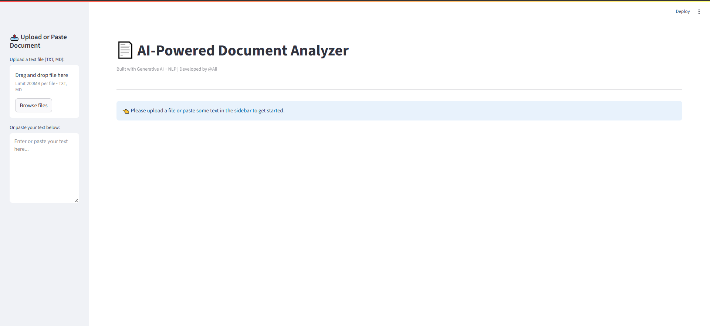

# AI Document Analyzer

Upload a contract, invoice, report or email and get, in seconds:

- **A clear summary** written by Claude (main point + key details), in the document's language
- **Key facts as a table** – people, organizations, dates, amounts, locations and action items – downloadable as CSV
- **Answers to questions** about the document, grounded only in its text (it says so when the answer isn't there)
- **Named entities** and a **sentiment timeline** using classic NLP (spaCy, TextBlob)

Built with Python and Streamlit on the Claude API.



## Who it's for

Anyone who reads long documents to pull out the same information every time: reviewing contracts, checking invoices, summarizing reports, triaging emails. The **Key facts** tab turns unstructured text into rows you can paste into Excel or a CRM.

## Features

| Tab | What it does | How |
|---|---|---|
| Summary | Abstractive summary + extractive "key sentences" | Claude · TF-IDF + cosine similarity |
| Key facts | People, organizations, dates, amounts, locations, action items → table + CSV | Claude, JSON output |
| Ask | Q&A that refuses to guess outside the document | Claude |
| Entities | Entity types chart and mention counts (English) | spaCy `en_core_web_sm` |
| Sentiment | Sentence-by-sentence sentiment (English) | TextBlob + Plotly |

- Reads **TXT, MD, PDF and DOCX** (Arabic text supported for the AI features)
- AI results are cached, so asking questions doesn't re-run the summary or extraction
- Clear message for scanned PDFs that have no selectable text

## Run it

```bash
pip install -r requirements.txt
cp .env.example .env          # then put your Anthropic API key in .env
streamlit run app/app_streamlit.py
```

Try it with `samples/service_agreement.txt`.

The model defaults to `claude-haiku-5-5` (fast and inexpensive). Set `CLAUDE_MODEL` in `.env` to use another one.

## Tests

```bash
python -m pytest -q
```

The tests cover file reading, sentence splitting, the extractive summary, entity extraction, charts, JSON parsing, the shape of the Claude requests (with a fake client, so no API key is needed) and an end-to-end run of the Streamlit app.

## Project structure

```
app/app_streamlit.py     # Streamlit interface
modules/
├── llm_processor.py     # Claude: summary, key facts, Q&A
├── loader.py            # TXT / MD / PDF / DOCX reading
├── summarizer.py        # extractive summary (TF-IDF)
├── spacy_nlp.py         # entities and sentiment
└── visualizer.py        # Plotly charts
samples/                 # example document
tests/
```

## Tech

Python · Claude API (Anthropic) · Streamlit · spaCy · TextBlob · scikit-learn · pypdf · python-docx · Plotly · pytest
